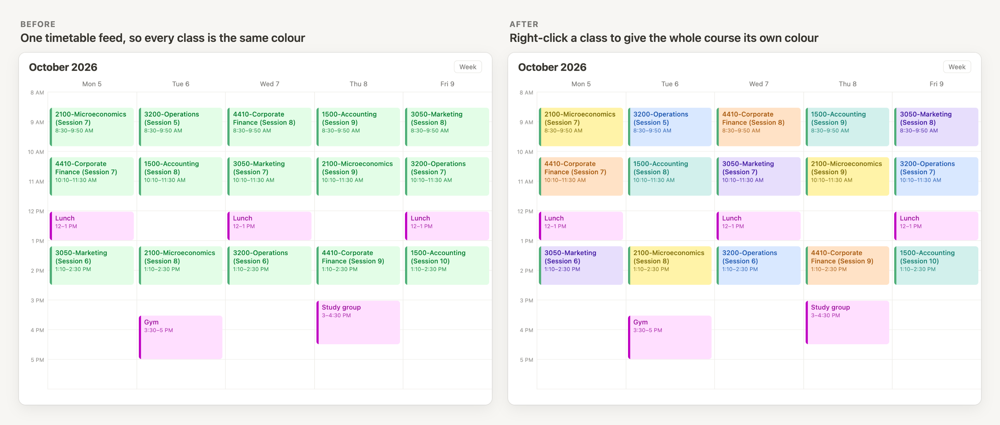
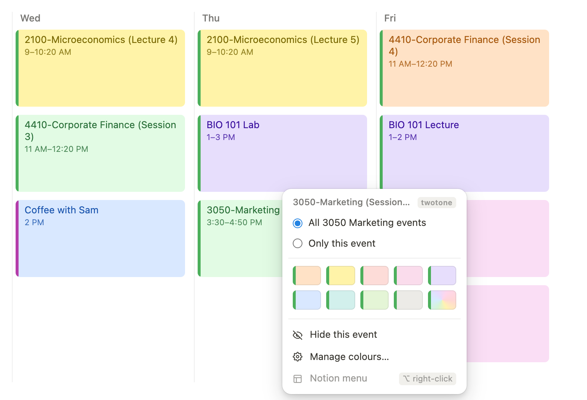
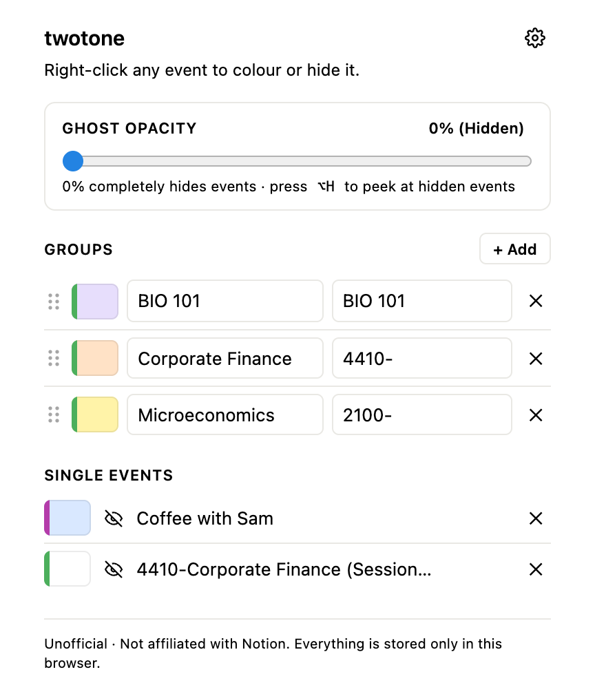

# TwoTone – Event Colours for Notion Calendar


**Colour-code your classes in Notion Calendar when they all come from one timetable feed.**



A school timetable usually arrives in [Notion Calendar](https://calendar.notion.so) as a single subscribed calendar, so every class is the same colour, and Notion won't let you recolour a calendar you don't own. TwoTone is an unofficial Chrome extension that fixes that: right-click a class and give the whole course its own colour. The calendar's colour bar on the left stays as it is, so you can still tell at a glance where an event came from.

> **Not affiliated with or endorsed by Notion Labs, Inc.** "Notion" is a trademark of Notion Labs, Inc.

## Who it's for

- **Students whose timetable is one calendar feed.** For example, a business school feed where every session is titled like `2100-Microeconomics (Session 7)`: one right-click on any session colours every session of that course, past and future.
- **Anyone with a shared or subscribed calendar they can't edit**, such as a team calendar, a sports fixture list or a room-booking feed, who wants some of its events to stand out.
- **People who want a tidier week.** Hide events you don't need to see, or fade them to a ghost.

It asks for one permission (`storage`), makes no network requests, and keeps everything in your browser. See [Privacy and permissions](#privacy-and-permissions).



## Why the bar stays

Notion Calendar colours every event by its calendar. TwoTone changes only the fill and leaves the bar alone, so you get both: the bar says "school", the fill says which class.

## Features

- **Right-click an event** to pick a colour for:
  - **every event in the same course.** Titles that start with a course code are recognised, like `2100-Microeconomics (Lecture 4)`, `BIO 101 Lab` or `CS-2100 Tutorial`.
  - **every event with the same title**, for events without a course code.
  - **only that one event.**
- 9 preset colours plus a custom colour picker. You can change the presets, and there's a separate set for dark mode.
- **Reset** one event to its calendar colour while the rest of its course keeps theirs.
- **Hide an event** you don't need to see. Hidden events can be left as faint "ghosts" instead (set how faint in the manager, or per event), and <kbd>Alt</kbd>+<kbd>H</kbd> (<kbd>⌥H</kbd> on a Mac) peeks at everything that's hidden.
- **Manage everything** from the toolbar button: rename, recolour, reorder or delete, or add your own rules by hand. Click a single event's title there to jump to it in the calendar.
- **Back up and restore** your colours as a file (gear icon → Backup).
- **Works from the keyboard.** In the colour menu, the arrow keys move between options, Enter picks, Escape closes.
- **Follows dark mode**, both the calendar's and your system's.
- **Notion's own right-click menu is still there.** Hold Alt (⌥ Option on a Mac) while you right-click, or choose **Notion menu** at the bottom of the colour menu.
- Colours stay put when you change weeks or views.



## Install

The extension isn't on the Chrome Web Store, so you load it yourself:

1. Download this repository: **Code → Download ZIP**, then unzip it.
2. Open `chrome://extensions` in Chrome.
3. Turn on **Developer mode** (top right).
4. Click **Load unpacked** and select the **`extension`** folder inside what you unzipped.
5. Reload Notion Calendar.

It should also work in other Chromium browsers such as Edge, Brave and Arc, through the same steps on their extensions page.

**Updating:** copy the new files over the old ones in the same `extension` folder, then click the reload arrow on the extension's card in `chrome://extensions`. Your colours are kept. Chrome treats a folder in a different location as a separate extension, which starts with no colours.

## Using it

- **Right-click an event**, choose what the colour applies to, then pick a colour.
- The menu preselects the whole course when the title has a course code, every event with the same title when another event on the page shares it, and otherwise only that event.
- Clicking a preset saves it straight away. The custom picker previews on the calendar as you drag and saves when you let go. Opening it changes nothing until you pick a colour.
- **Reset** appears in the menu once there's something to reset.
- Group rules match an event's title, not its time or location. Plain text is a case-insensitive "contains" match (`2100-` matches every title containing `2100-`). In the manager you can also type a regular expression such as `/2100|micro/i`.
- When more than one group matches an event, the one nearest the top of the manager wins. Drag groups to reorder them; recolouring a group doesn't move it. A colour set for "only this event" always wins.
- Past events can't be hidden, and a hidden event comes back once its day has passed.

## Privacy and permissions

- **Permissions:** `storage` only.
- **Runs on:** `calendar.notion.so` and `calendar.notion.com` only.
- **No network access.** The extension makes no requests, loads no remote code and has no analytics.
- **What's stored:** your colour rules and palettes, plus the title and date of each event you colour or hide individually. They're kept in `chrome.storage.local` in your browser profile. They aren't synced and are never sent anywhere. Removing the extension deletes them, so export a backup first if you want to keep them.
- Single-event entries are removed automatically about six months (180 days) after the event's date. Group rules are never removed.
- A backup is a plain JSON file saved by your browser's own download. Importing one checks every value before using it.
- The extension can read the text of the calendar page in order to match event titles. That text stays in the page.

## How it works

Each event in Notion Calendar is rendered as a `<div data-event-chip-key="…">`. Its fill comes from the CSS variable `--background-color` and its left bar from `--ribbon-color-primary` / `--ribbon-color-secondary`.

The content script tags a matching event with `data-twotone="<colour>"`. A generated stylesheet overrides `--background-color` and sets an automatically paired, high-contrast `--text-color` for that tag, so the calendar's ribbon bar and everything else Notion draws is untouched. A `MutationObserver` re-tags just the events Notion re-renders, before the browser paints, so there's no flash of the old colour.

Notion fades events that are over by washing out their text colour. The script spots that on each chip and fades its own text colour the same way. It also works out which day each column shows, from the day headers and the URL, so the manager can list a single event's date and so past events can't be hidden.

Because this relies on Notion's internal markup, a Notion update could break it. If colours stop showing up, please [open an issue](../../issues).

## Known limitations

- **"Only this event" colours** are tied to Notion's internal event key. If Notion changes how events are keyed, those may need re-applying. Group colours match titles and aren't affected.
- **While an event is selected**, Notion's own highlight shows instead of your colour. Your colour comes back when you click away.
- **Colours don't change with the theme.** A pastel picked in light mode stays pastel if you switch the calendar to dark mode; the dark presets are only offered while the calendar is dark.
- **Fading of past events follows Notion's own.** The extension reads the washed-out text colour Notion gives an event that's over, and fades a recoloured event to match. If Notion stops marking events that way, it falls back to working the date out from day headers like "Wed 30", which doesn't cover month view.
- **Hiding an event doesn't reflow the calendar.** Events that overlapped it keep their narrower width.
- **Course detection covers common formats**: a number then a dash (`2100-…`), or letters then a number (`BIO 101`, `CS-2100`). For anything else, use "All events with this title" or add a rule in the manager.

## Development

```sh
npm install
npx playwright install chromium
npm test                 # load the extension into Chromium and run the checks
npm run screenshots      # same, and refresh docs/menu.png and docs/manager.png
npm run showcase         # rebuild the before/after images and docs/social-preview.png
```

The test serves `tests/mock-calendar.html` (and `tests/mock-past.html`, for past events), stand-ins that copy the parts of Notion Calendar's markup the extension relies on, at `https://calendar.notion.so`. It then drives the real extension. The mock can't prove the extension still works against today's Notion Calendar, so check a real calendar by hand before a release.

The before/after images come from `tests/mock-showcase.html`, a made-up week of classes, coloured by the real extension. `docs/social-preview.png` is sized for GitHub's **Settings → Social preview**.

The extension itself is plain JavaScript with no build step. `shared.js` holds what the content script and the manager both use (colour maths, the colour picker, backup checks). Edit files in `extension/`, then click reload on the extension in `chrome://extensions`.

## Contributing

Issues and pull requests are welcome.

This extension deliberately has one permission and no network access, and changes should keep it that way. Pull requests that add permissions, network requests, remote code or `eval` won't be merged without a very good reason. Event titles come from whoever sent the invite, so any new code must treat them as plain text, never as HTML or code.

## Security

To report a security problem, please use [private vulnerability reporting](../../security/advisories/new) rather than a public issue. See [SECURITY.md](SECURITY.md).

## License

[MIT](LICENSE)
